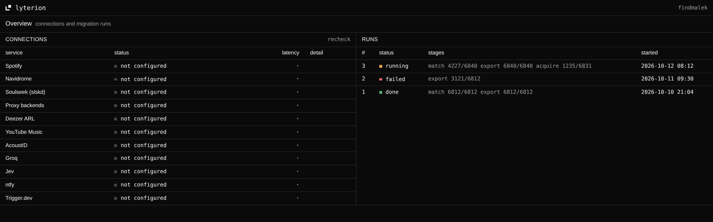

<div align="center">


# lyterion

**Your Spotify library, released onto your own Navidrome.**
Liked songs, saved albums, followed artists and every playlist with its order and cover, each track found
across many sources, verified, tagged and placed on one self-hosted box.

[](https://lyterion.findmalek.engineer)




</div>

*λυτήριον: release, deliverance.* A personal, single-owner tool (D-001). One instance serves one person,
with their own Spotify developer app, and runs entirely in the homelab (D-003).

## What it does

| stage | |
|---|---|
| **export** | Reads liked songs, saved albums, followed artists and owned or followed playlists (order, cover, description) through the owner's Spotify app. A daily `spotify.sync` keeps it current until Premium is cancelled. |
| **match** | ISRC first, then normalized artist + title within ±2s. Recordings are deduped, so a song on a single, an album and a compilation becomes one file. Only fuzzy picks go to an LLM; low confidence goes to review. |
| **acquire** | Searches every provider before choosing: the existing library, Soulseek (slskd), lossless proxy backends, Anna's Archive, YouTube Music last. Transparent beats lossless, match confidence beats speed. |
| **verify** | Decode check, duration, AcoustID fingerprint and a spectral check that catches fake FLAC and fake bitrates. A failure moves on to the next candidate. |
| **place** | Full MusicBrainz tags, embedded 1200px art plus `cover.jpg`, synced `.lrc`, ReplayGain, written under `/srv/music/lyterion/` in beets' path format. Never touches files it didn't write. |
| **playlists** | `.m3u8` files with sidecar covers, so every Subsonic client sees them. Liked songs are starred. |
| **upgrade** | Rate a song 1 star (or add it to `⇪ Upgrade`) from any client and it's re-searched for a better source, with an ntfy push when it lands. |

## Quality

Transparent, not maximum (D-017): FLAC is stored at 16-bit/44.1kHz, and lossy is final at MP3 ≥ 256 / V0,
AAC ≥ 256 or Opus/Vorbis ≥ 160. Anything below is kept so the library is complete, and is the only thing the
weekly `quality.upgrade` targets.

## How it fits together

```
dashboard ──oRPC──▶ api (Better Auth, Spotify OAuth) ──▶ Postgres
                     │
                     └─trigger─▶ Trigger.dev (self-hosted)
                                   spotify.export → match.batch → acquire.* → verify → place → playlists.sync
                                        │              │             │                    │
                                     Spotify      MusicBrainz    slskd (gluetun VPN)   /srv/music/lyterion
                                                  Groq / Jev     proxy backends, yt-dlp      │
                                                                 Anna's Archive          Navidrome scan
```

Stages advance on events, not long waits: each batch updates counters and the last finisher starts the next
stage (D-014). Progress per stage is stored as JSONB and shown live on the dashboard.

## Monorepo

| path | |
|---|---|
| `apps/api` | Next.js route handlers: oRPC, Better Auth, Trigger.dev tasks |
| `apps/dashboard` | connections, runs, review. Monochrome, square corners, mono for data |
| `packages/db` | Drizzle schema and migrations |
| `packages/env` | every `LYTERION_*` variable, validated with zod |
| `packages/auth` | Better Auth with the owner-only gate |
| `packages/orpc` | routers, procedures, middleware |
| `packages/common` | Spotify, identity, providers, library, pipeline and notify code, plus the Trigger tasks |
| `packages/core` | the wired-up auth instance the api serves |
| `packages/ui` | shadcn with `--radius: 0`, logo, theme |
| `packages/logger`, `ai-provider`, `config` | pino logger, `getAIModel(task)`, shared tsconfig |

## Develop

```bash
pnpm install
cp .env.example .env          # the Better Auth secret is the only must
pnpm db:setup                 # Postgres on :5434, then push the schema
pnpm dev:ad                   # api :3001, dashboard :3002, trigger dev
```

First run: open the dashboard and follow `/onboarding`. It asks for the setup code the api prints on boot,
walks through creating the Spotify app (redirect URI `http://localhost:3001/api/auth/callback/spotify`,
owner on its allowlist), signs you in as the owner, then connects Navidrome. No secret needs a redeploy.
CI runs `biome ci`, `pnpm build` and `pnpm test`.

## Deploy

Images are built on GitHub runners and pushed to `ghcr.io/findmalek/lyterion-{api,dashboard}`, then Dokploy
on `the-keep` redeploys `lyterion-dashboard` and `lyterion-api`; the api runs migrations on start. Every PR
gets its own preview apps and database with a sticky status comment. See [docs/infra.md](docs/infra.md).

Setting up an instance from scratch, Proton VPN included: [docs/setup.md](docs/setup.md).

## Docs

Start at [docs/README.md](docs/README.md). [decisions.md](docs/decisions.md) holds every settled decision
with its reason and wins over everything else; [plan.md](docs/plan.md) has the milestones.

## Siblings

Same look, same box: [keep dashboard](https://github.com/FindMalek/keep-dashboard) and
[keep music](https://github.com/FindMalek/keep-player), which plays what Lyterion places.
